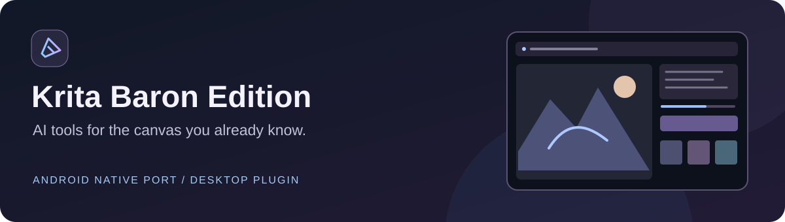

# Krita AI Diffusion — Baron Edition

A desktop fork of [Acly's Krita AI Diffusion](https://github.com/Acly/krita-ai-diffusion),
with a companion native Android edition. Generate, inpaint, edit, upscale and use
references directly in Krita. **Acly and contributors remain the original authors;
Darxarz / Baron Edition provides modifications and the Android port.**

## Download

| Package | Download |
| --- | --- |
| Desktop plugin · Krita 5.x / Qt5 | **[1.53.0-baron.14 ZIP](https://github.com/Darxarz/krita-ai-diffusion-baron-edition/releases/download/v1.53.0-baron.14/krita_ai_diffusion-1.53.0-baron.14.zip)** |
| Android application · ARM64, Android 7+ | **[Krita Baron Edition 0.1.35 APK](https://github.com/Darxarz/krita-baron-android/releases/download/v0.1.35/krita-baron-android-arm64-v0.1.35.apk)** |
| Android project | [Source, installation and remaining port differences](https://github.com/Darxarz/krita-baron-android) |

## Baron additions

- Qwen Image 2.1 discovery and editing, Krea 2 editing/reference presets and identity options.
- Foreground/background extraction as a dedicated workspace with editable masks.
- Model/LoRA galleries and preview handling, browser sign-in for a compatible custom
  backend, reconnect/result recovery and a separate Baron update channel.
- Optional A1111 prompt syntax and GPU-noise options on supported servers.
- Public expressive font collection and translations for the added controls.

The original Generation, Live, Upscale, Custom/Graph and Animation workspaces remain
part of the desktop plugin. The Android edition has a smaller feature set:
[up-to-date comparison](https://github.com/Darxarz/krita-baron-android/blob/main/docs/CURRENT_PARITY.md).

## Install

1. Download the **plugin ZIP** from Releases.
2. In Krita, choose **Tools → Scripts → Import Python Plugin from File** and select it.
3. Restart Krita; enable the plugin under **Settings → Configure Krita → Python Plugin Manager**.
4. Open the **Krita AI Diffusion Baron Edition** docker and connect to your backend.

This uses the original `ai_diffusion` identifier and replaces an existing version.
Use the release ZIP, not GitHub's automatically generated Source code ZIP, to install.
Models and inference run on the configured server. Backend support determines
which model and reference combinations are available.

## Original project and documentation

[Original plugin](https://github.com/Acly/krita-ai-diffusion) ·
[Handbook](https://docs.interstice.cloud) · [Preserved upstream README](UPSTREAM_README.md)
· [Native Android port](https://github.com/Darxarz/krita-baron-android)

Krita is created by the Krita team and contributors. Baron Edition is an independent
modified edition, not an official Acly or Krita release. Existing authorship and
licenses are preserved. [GPL-3.0-or-later](LICENSE) · [Contributing](CONTRIBUTING.md).
